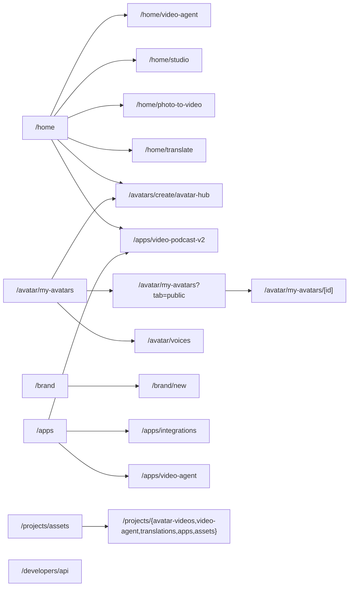

# HeyGen Reference Exhaustive Navigation Graph (ANTIGRAVITY V6)

- **Generated At**: `2026-11-22T16:44:43.603Z`
- **Reference Root**: `https://app.heygen.com/home`
- **Total Canonical Reference Routes**: **17**

## 1. Navigation Topology (Mermaid)

## 2. Discovered Route Transitions & Trigger Sources

| Source Surface | Trigger Action | Destination Route / Modal |
| :--- | :--- | :--- |
| Primary Left Icon Rail | Click `Home`, `Avatar`, `Brand`, `Apps`, `Projects`, `Developers` | `/home`, `/avatar/my-avatars`, `/brand`, `/apps`, `/projects/assets`, `/developers/api` |
| `/home` Onboarding Step 1 | Click `Get Started` on `Create your Avatar` | `/avatars/create/avatar-hub` |
| `/home` Video Prompts (Cards 1–5) | Click `Create Now` on `Ads & Promo`, `Educational Video`, `Expert Explainer`, `Tips & How-To`, `News Brief Video` | Opens **Video Agent Prompt Modal** (`760×792px`) inline on `/home` |
| `/home` Video Prompts (Card 6) | Click `Create Now` on `Video Podcast` | `/apps/video-podcast-v2` |
| `/home/video-agent` Left Card | Click `Intros`, `Captions`, `Format`, `Brand` | Opens inline left-column drawers (`27 Intros`, `75 Captions`, `4 Formats`, `3 Brand Presets`) |
| `/home/video-agent` Bottom Gallery | Switch 6 tabs (`For You`, `Personal Brand`, `Course & E-learning`, `Corporate Training`, `Creator Channels`, `Real Estate`) | Renders 29 template cards; clicking `Video Podcast` navigates to `/apps/video-podcast-v2`; clicking any other opens Video Agent Prompt Modal |
| `/avatars/create/avatar-hub` | Click `Myself` or `A new character` | Transitions to `Let's create your avatar` equation screen (`Appearance + Motion + Voice` or `Appearance + Voice`) |
| `/brand` | Click `+ New Brand System` | `/brand/new` (Website URL Importer + 6 Category Tabs + 49 Brand Presets across 7 sections) |
| `/apps` | Click app cards | `/apps/video-agent`, `/apps/video-podcast-v2`, `/apps/creative-studio/video`, `/apps/ppt-to-video`, `/apps/avatar-shots?mode=cinematic`, `/apps/studio`, `/apps/business-card`, `/apps/upscale-video`, `/apps/speech-cleanup`, `/apps/instant-highlights`, `/apps/translate`, `/apps/batch-mode`, or Business Upgrade Modal (`Interactive Video`) |
